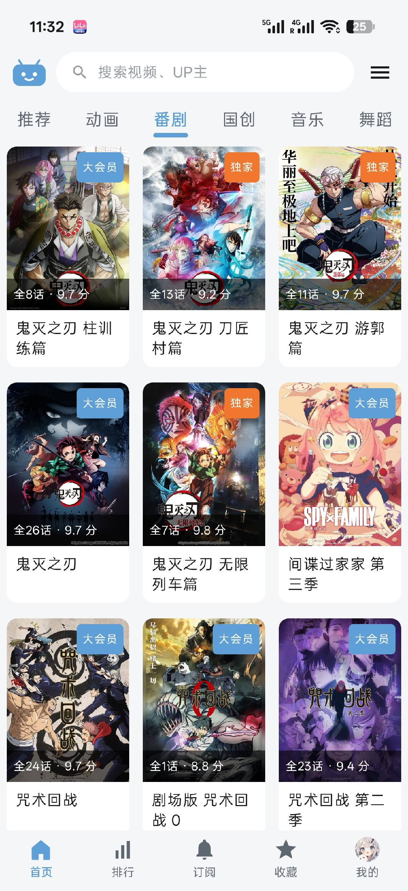
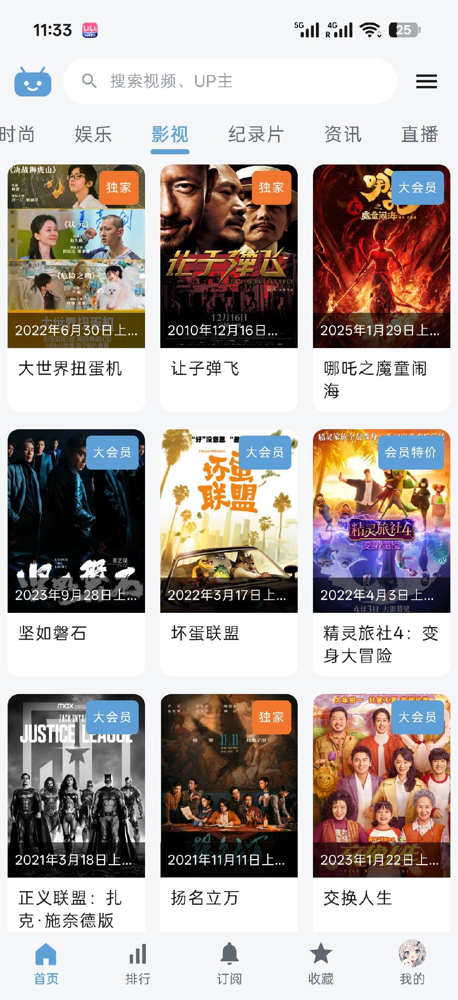
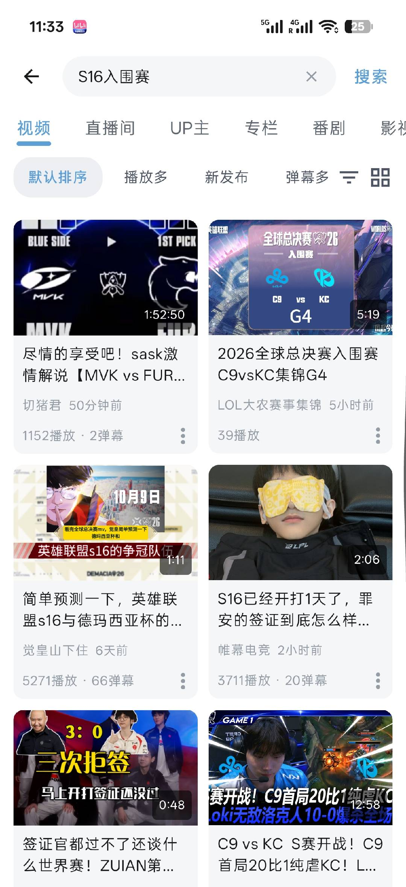

<div align="center">


# 彼可 BiKo

**一个用 Kotlin + Jetpack Compose 从零写起的第三方哔哩哔哩 Android 客户端**

简洁 · 流畅 · 现代化 · 纯原生 Compose

[](#)
[](#)
[](#)
[](#)
[](https://github.com/shj142506-cyber/BiKo/releases)
[](https://github.com/shj142506-cyber/BiKo/stargazers)

[下载最新版 APK](https://github.com/shj142506-cyber/BiKo/releases/latest) · [问题反馈](https://github.com/shj142506-cyber/BiKo/issues) · [查看源码](#目录结构) · [**English**](README_EN.md)

</div>

---

**English**: BiKo is an unofficial, third-party **Bilibili** client for Android, written from scratch in **Kotlin + Jetpack Compose** (no WebView shell). It covers video playback (Media3 / ExoPlayer, DASH & HLS), a custom **danmaku** engine (standard, protobuf, and advanced BAS/Lua danmaku), live streaming, dynamic posts, direct messages, search, user space, favorites, history, and offline download. → [**Read the full English README**](README_EN.md)

---

## 项目介绍

**彼可 BiKo** 是一个完全使用 **Kotlin + Jetpack Compose** 编写的第三方哔哩哔哩客户端。

它不是一个「套壳 App」，而是把 B 站的公开接口能力（视频、直播、动态、弹幕、用户空间等）重新组织成一套干净的现代 Android 架构：UI 全部由 Compose 声明式构建，网络层基于 Retrofit + OkHttp + kotlinx.serialization，播放器基于 AndroidX Media3 并自研了弹幕渲染引擎。

项目的目标很简单——**用最现代的技术栈，把「看视频」这件事做到又轻又快又好看。**

> 适合想学习 **Compose 实战**、**Media3 播放器**、**弹幕引擎实现**、**WBI 签名与接口逆向** 的开发者阅读与参考。

---

## 效果预览

| 首页 · 推荐 | 首页 · 番剧 | 首页 · 影视 | 首页 · 直播 | 搜索 |
| --- | --- | --- | --- | --- |
|  |  |  |  |  |

---

## 功能亮点

| 模块 | 能力 |
| --- | --- |
| **首页 / 推荐** | 瀑布流推荐视频、分区入口、稍后再看、收藏与历史的桌面快捷方式 |
| **视频播放** | Media3 (ExoPlayer) DASH / HLS 播放、倍速、画质切换、后台播放、画中画、媒体通知栏控制 |
| **弹幕引擎** | 自研解析与渲染，支持普通弹幕、Proto 弹幕、**高级弹幕（BAS Lua 脚本）**，多层轨道调度 |
| **直播** | 直播间播放、直播间弹幕（WebSocket 实时）、清晰度选择 |
| **短视频** | 竖屏沉浸式上下滑动播放 |
| **动态** | 动态流浏览、发布动态、话题详情 |
| **消息** | 系统通知、回复我的、@ 我的、收到的赞、私信会话 |
| **搜索** | 视频 / 用户搜索、热搜、搜索历史 |
| **个人空间** | 用户主页、投稿列表、关注 / 粉丝、追番列表、关注分组 |
| **收藏 / 历史 / 下载** | 收藏夹与收藏夹详情、观看历史、离线下载任务管理 |
| **图文 / 专栏** | 专栏文章详情与富文本解析 |
| **登录** | 扫码登录、Cookie 会话（SESSDATA / bili_jct）本地安全保存 |
| **体验细节** | Material 3 动态配色、夜间模式、播放进度记忆、不感兴趣过滤 |

---

## 快速开始

### 方式一：直接安装（推荐）

1. 前往 [Releases](https://github.com/shj142506-cyber/BiKo/releases/latest) 下载 `BiKo-x.x.x.apk`；
2. 传到手机安装，首次需在系统设置里允许「安装未知来源应用」；
3. 打开 App，用**扫码登录**即可。

> 当前 Release 的 APK 为 **debug 签名**，仅供体验测试，请勿用于正式分发。

### 方式二：从源码构建

1. 使用 **Android Studio（Ladybug 或更新版本）** 打开项目根目录；
2. 首次打开会自动生成 `local.properties`，如需手动指定请写入 `sdk.dir=<你的 Android SDK 路径>`；
3. 等待 **Gradle Sync** 完成，直接运行 `app` 配置，或执行 `./gradlew assembleDebug`。

**环境要求**

| 项目 | 要求 |
| --- | --- |
| JDK | 17 |
| Android Studio | Ladybug (2024.2) 或更新 |
| Android SDK | API 34（compileSdk / targetSdk） |
| 最低运行版本 | Android 7.0（API 24） |

> 提示：仓库未包含 Gradle Wrapper（`gradlew`）。命令行构建请使用 Android Studio 自带的 Gradle，或先执行 `gradle wrapper` 生成。

---

## 技术栈

| 类别 | 选型 |
| --- | --- |
| 语言 | Kotlin 2.0.21 |
| UI | Jetpack Compose + Material 3 + Navigation Compose |
| 网络 | Retrofit 2.11 + OkHttp 4.12 + kotlinx.serialization 1.7 |
| 播放 | AndroidX Media3 1.4 (ExoPlayer: DASH / HLS / Session) |
| 图片 | Coil 2.7 |
| 本地存储 | DataStore Preferences 1.1 |
| 二维码 | ZXing 3.5 |
| 构建 | AGP 8.5.2 · Gradle Kotlin DSL · KSP |

- 包名 / 应用 ID：`com.biko.client`
- 版本：`0.1.0-beta.1`（versionCode 15）

---

## 目录结构

```
app/src/main/java/
├── com/biko/client/
│   ├── data/                  # 数据层
│   │   ├── local/             # DataStore 持久化（会话、历史、下载、设置、夜间模式…）
│   │   ├── model/             # 数据模型
│   │   ├── remote/            # BiliApi、DTO、WBI 签名、短信签名、弹幕分段解析
│   │   └── BiliRepository*.kt # 按业务域拆分的仓库层（视频/直播/动态/搜索/消息/关系…）
│   ├── player/                # 播放服务、DASH 播放、直播弹幕、媒体控制
│   ├── ui/
│   │   ├── screens/           # 25+ 个功能页面（首页、播放、直播、动态、空间、搜索…）
│   │   ├── components/        # 通用组件、播放器、弹幕与高级弹幕覆盖层
│   │   └── theme/             # Material 3 主题与配色
│   └── util/                  # 工具函数与格式化
└── com/android/purebilibili/danmaku/
    ├── engine/                # 弹幕数据模型与渲染引擎
    └── parser/                # BAS 脚本解析、Proto 弹幕、加权文本
```

---

## 常见问题

**Q：为什么安装时提示「未知来源」？**
A：因为 APK 未经应用商店分发，属于正常现象，在系统设置中允许安装即可。

**Q：需要登录才能用吗？**
A：浏览首页、搜索、看视频等基本功能无需登录；收藏、历史、动态、私信等需要扫码登录。

**Q：会收集我的数据吗？**
A：不会。项目没有自建服务器，所有数据直连官方接口，登录会话仅保存在设备本地。

---

## 免责声明

本项目为**个人学习与技术研究**用途的非官方客户端，与哔哩哔哩官方**无任何关联**，也未获得其授权或认可。

所有内容版权归原权利人所有。请仅用于学习交流，**不得用于任何商业用途**。因使用本项目产生的任何后果由使用者自行承担。

---

## 许可证

本项目基于 **MIT License** 开源，详见 [LICENSE](LICENSE)。

<div align="center">

**如果这个项目对你有帮助，欢迎点一个 Star 支持一下**

</div>
